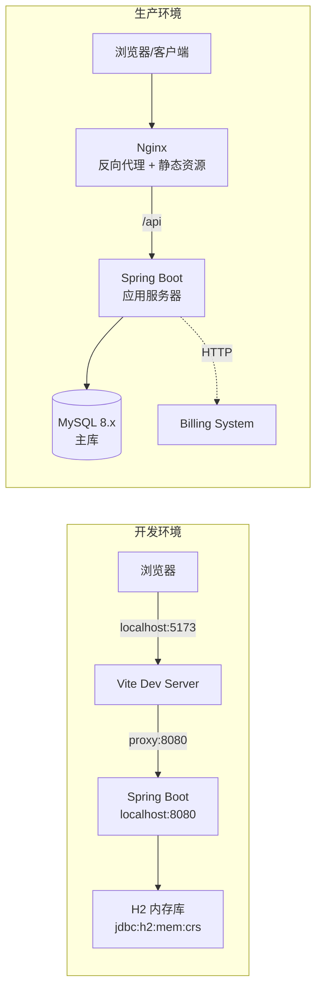
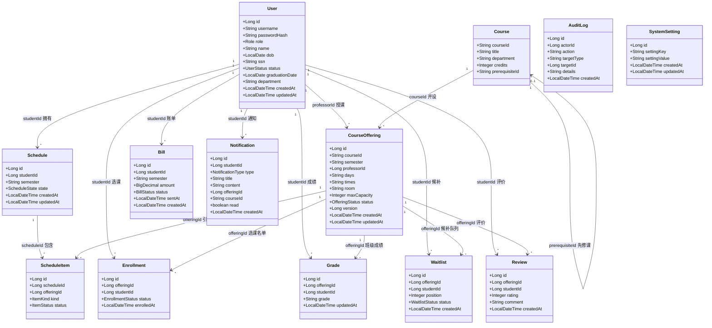
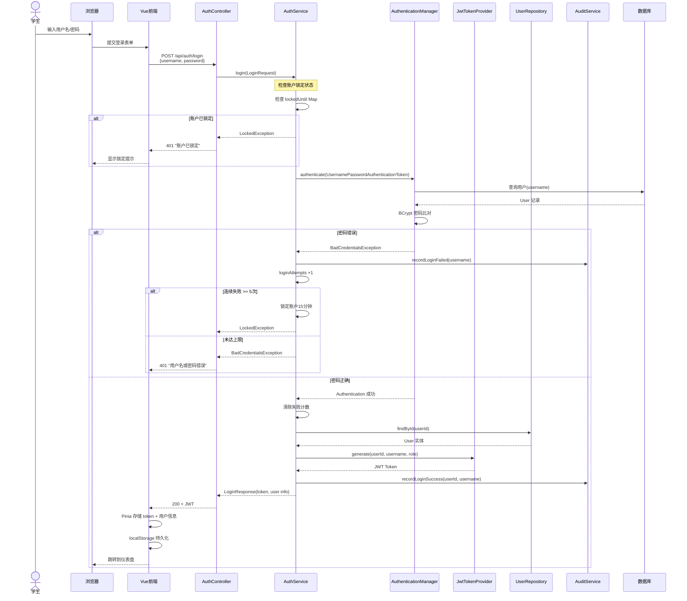
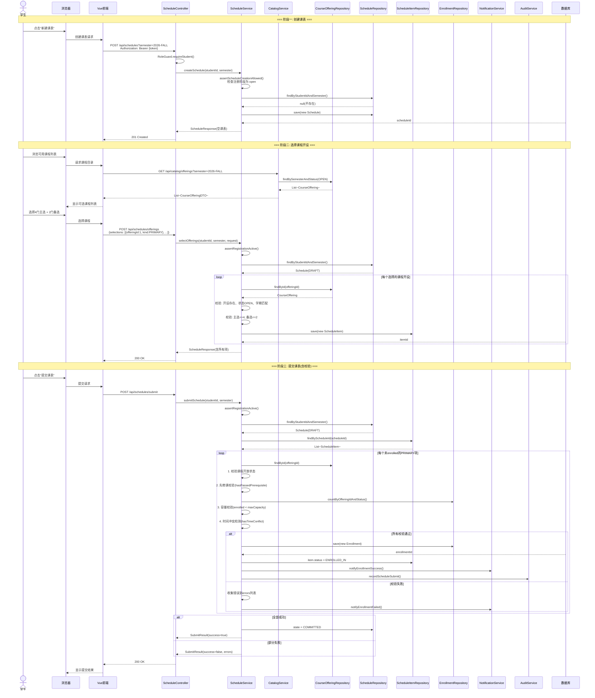
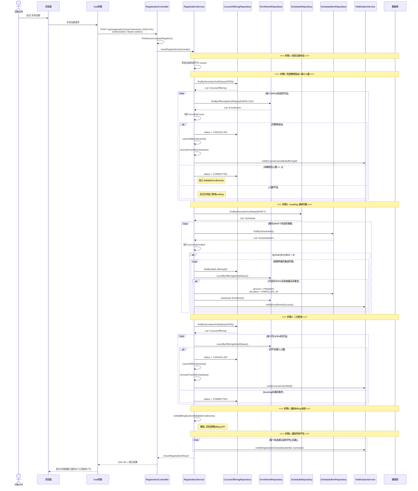
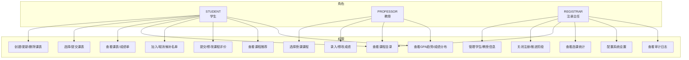

# 课程注册系统 (CRS) 设计文档

> Wylie College 课程注册系统,替代遗留大型机系统,采用三层 B/S 架构。

---

## 1. 系统架构

### 1.1 整体架构图

```mermaid
graph TB
    subgraph 客户端
        Browser[浏览器]
    end

    subgraph 前端层
        VueApp[Vue 3 + Vite<br/>Element Plus + Pinia + Vue Router]
    end

    subgraph 后端层
        SpringBoot[Spring Boot 3.3<br/>Java 21]
        subgraph 安全模块
            JWT[JwtTokenProvider<br/>JwtAuthenticationFilter]
            SpringSecurity[Spring Security<br/>BCrypt 密码哈希]
        end
        subgraph 控制器层
            AuthCtrl[AuthController]
            ScheduleCtrl[ScheduleController]
            TeachingCtrl[TeachingController]
            GradeCtrl[GradeController]
            UserCtrl[UserController]
            RegCtrl[RegistrationController]
            ReportCardCtrl[ReportCardController]
            CatalogCtrl[CatalogController]
            NotifCtrl[NotificationController]
            HealthCtrl[HealthController]
            WaitlistCtrl[WaitlistController]
            ReviewCtrl[ReviewController]
            RecCtrl[RecommendationController]
            EnrollStatsCtrl[EnrollmentStatsController]
            GradeStatsCtrl[GradeStatsController]
            SettingsCtrl[SystemSettingController]
            AuditLogCtrl[AuditLogController]
            DeadlineCtrl[DeadlineReminderController]
        end
        subgraph 服务层
            AuthService[AuthService]
            ScheduleService[ScheduleService]
            TeachingService[TeachingService]
            GradeService[GradeService]
            UserService[UserService]
            RegistrationService[RegistrationService]
            ReportCardService[ReportCardService]
            CatalogService[CatalogService]
            NotificationService[NotificationService]
            AuditService[AuditService]
            WaitlistSvc[WaitlistService]
            ReviewSvc[ReviewService]
            RecSvc[RecommendationService]
            EnrollStatsSvc[EnrollmentStatsService]
            GradeStatsSvc[GradeStatsService]
            SettingsSvc[SystemSettingService]
            AuditLogSvc[AuditLogQueryService]
            BillingAsyncSvc[BillingAsyncService]
            BillingRetrySvc[BillingRetryService]
            CapacityNotifSvc[CapacityNotificationService]
            DeadlineSvc[DeadlineReminderService]
        end
        subgraph 适配器层
            CatAdapter[CatalogAdapter]
            LegacyAdapter[LegacyCatalogAdapter]
            CachedAdapter[CachedCatalogAdapter]
            DirectAdapter[DirectCatalogAdapter]
        end
        subgraph 数据访问层
            JPA[JPA Repository<br/>Spring Data JPA]
        end
        subgraph 基础设施
            WebSocket[WebSocket<br/>SockJS+STOMP]
            AsyncTask[Async 异步任务]
        end
    end

    subgraph 数据库层
        H2[(H2 内存库<br/>开发环境)]
        MySQL[(MySQL 8.x<br/>生产环境)]
    end

    subgraph 外部系统
        BillingSystem[Billing System<br/>账单系统]
    end

    Browser --> VueApp
    VueApp -->|REST API + JWT| SpringBoot
    SpringBoot --> AuthCtrl
    SpringBoot --> ScheduleCtrl
    SpringBoot --> TeachingCtrl
    SpringBoot --> GradeCtrl
    SpringBoot --> UserCtrl
    SpringBoot --> RegCtrl
    SpringBoot --> ReportCardCtrl
    SpringBoot --> CatalogCtrl
    SpringBoot --> NotifCtrl
    SpringBoot --> HealthCtrl
    SpringBoot --> WaitlistCtrl
    SpringBoot --> ReviewCtrl
    SpringBoot --> RecCtrl
    SpringBoot --> EnrollStatsCtrl
    SpringBoot --> GradeStatsCtrl
    SpringBoot --> SettingsCtrl
    SpringBoot --> AuditLogCtrl
    SpringBoot --> DeadlineCtrl
    AuthCtrl --> AuthService
    ScheduleCtrl --> ScheduleService
    TeachingCtrl --> TeachingService
    GradeCtrl --> GradeService
    UserCtrl --> UserService
    RegCtrl --> RegistrationService
    ReportCardCtrl --> ReportCardService
    CatalogCtrl --> CatalogService
    NotifCtrl --> NotificationService
    WaitlistCtrl --> WaitlistSvc
    ReviewCtrl --> ReviewSvc
    RecCtrl --> RecSvc
    EnrollStatsCtrl --> EnrollStatsSvc
    GradeStatsCtrl --> GradeStatsSvc
    SettingsCtrl --> SettingsSvc
    AuditLogCtrl --> AuditLogSvc
    DeadlineCtrl --> DeadlineSvc
    AuthService --> SpringSecurity
    AuthService --> JWT
    ScheduleService --> JPA
    TeachingService --> JPA
    GradeService --> JPA
    UserService --> JPA
    RegistrationService --> JPA
    ReportCardService --> JPA
    CatalogService --> CatAdapter
    NotificationService --> JPA
    WaitlistSvc --> JPA
    ReviewSvc --> JPA
    RecSvc --> JPA
    EnrollStatsSvc --> JPA
    GradeStatsSvc --> JPA
    SettingsSvc --> JPA
    AuditLogSvc --> JPA
    BillingAsyncSvc --> JPA
    BillingRetrySvc --> JPA
    CapacityNotifSvc --> JPA
    DeadlineSvc --> JPA
    CatAdapter --> LegacyAdapter
    CatAdapter --> CachedAdapter
    CatAdapter --> DirectAdapter
    CapacityNotifSvc --> WebSocket
    DeadlineSvc --> WebSocket
    JPA --> H2
    JPA --> MySQL
    RegistrationService -.->|模拟调用| BillingSystem
    BillingAsyncSvc -.-> BillingSystem
```



### 1.2 技术栈说明

| 层          | 技术            | 版本 | 说明                                          |
|-------------|-----------------|------|-----------------------------------------------|
| 前端框架    | Vue 3           | 3.x  | 组合式 API,响应式                             |
| 构建工具    | Vite            | 8.x  | 快速热重载,代码拆分(Element Plus/Vendor/Main) |
| UI 组件库   | Element Plus    | 2.x  | 企业级 UI 组件                                |
| 状态管理    | Pinia           | 2.x  | 认证状态、用户信息                            |
| 路由        | Vue Router      | 4.x  | 路由守卫(未登录跳转)                          |
| HTTP 客户端 | Axios           | 1.x  | 请求拦截器自动携带 JWT                        |
| 后端框架    | Spring Boot     | 3.3  | 自动配置、嵌入式容器                          |
| JDK         | OpenJDK         | 21   | 虚拟线程、Switch 表达式                       |
| 安全框架    | Spring Security | 6.x  | 无状态认证、角色授权                          |
| JWT         | jjwt            | 0.12 | 令牌生成/校验                                 |
| ORM         | Spring Data JPA | 3.x  | Hibernate 实现                                |
| 开发数据库  | H2              | 2.x  | 内存模式,零配置                               |
| 生产数据库  | MySQL           | 8.x  | 事务、索引优化                                |
| 密码加密    | BCrypt          | -    | Spring Security 内置                          |

### 1.3 部署架构



---

## 2. 数据库设计

### 2.1 ER 图

```mermaid
erDiagram
    app_user {
        BIGINT id PK "自增主键"
        VARCHAR username UK "用户名,唯一"
        VARCHAR password_hash "密码哈希(BCrypt)"
        VARCHAR role "角色: STUDENT/PROFESSOR/REGISTRAR"
        VARCHAR name "姓名"
        DATE dob "出生日期"
        VARCHAR ssn "社会安全号"
        VARCHAR status "状态: ACTIVE/INACTIVE"
        DATE graduation_date "预计毕业日期(学生)"
        VARCHAR department "院系(教授)"
        TIMESTAMP created_at "创建时间"
        TIMESTAMP updated_at "更新时间"
        INT failed_login_attempts "连续失败登录次数"
        TIMESTAMP locked_until "账户锁定截止时间"
    }

    course {
        VARCHAR course_id PK "课程编号,如 CS101"
        VARCHAR title "课程名称"
        VARCHAR department "所属院系"
        INT credits "学分,默认3"
        VARCHAR prerequisite_id FK "先修课编号(自引用)"
    }

    course_offering {
        BIGINT offering_id PK "自增主键"
        VARCHAR course_id FK "课程编号"
        VARCHAR semester "学期,如 2026-FALL"
        BIGINT professor_id FK "教授ID(可为空)"
        VARCHAR days "上课日,如 MWF/TR"
        VARCHAR times "上课时间,如 09:00-10:00"
        VARCHAR room "教室"
        INT max_capacity "最大容量,默认10"
        VARCHAR status "状态: OPEN/COMMITTED/CLOSED/CANCELLED"
        TIMESTAMP created_at "创建时间"
        TIMESTAMP updated_at "更新时间"
        BIGINT version "乐观锁版本号"
    }

    schedule {
        BIGINT schedule_id PK "自增主键"
        BIGINT student_id FK "学生ID"
        VARCHAR semester "学期"
        VARCHAR state "状态: DRAFT/COMMITTED/CLOSED"
        TIMESTAMP created_at "创建时间"
        TIMESTAMP updated_at "更新时间"
    }

    schedule_item {
        BIGINT id PK "自增主键"
        BIGINT schedule_id FK "课表ID"
        BIGINT offering_id FK "开设ID"
        VARCHAR kind "类型: PRIMARY/ALTERNATE"
        VARCHAR status "状态: SELECTED/ENROLLED_IN/CANCELLED"
    }

    enrollment {
        BIGINT id PK "自增主键"
        BIGINT offering_id FK "开设ID"
        BIGINT student_id FK "学生ID"
        VARCHAR status "状态: ENROLLED/CANCELLED"
        TIMESTAMP enrolled_at "注册时间"
    }

    grade {
        BIGINT id PK "自增主键"
        BIGINT offering_id FK "开设ID"
        BIGINT student_id FK "学生ID"
        VARCHAR grade "成绩: A/B/C/D/F/I"
        TIMESTAMP updated_at "更新时间"
    }

    bill {
        BIGINT bill_id PK "自增主键"
        BIGINT student_id FK "学生ID"
        VARCHAR semester "学期"
        DECIMAL amount "金额"
        VARCHAR status "状态: PENDING/SENT/FAILED"
        TIMESTAMP sent_at "发送时间"
        TIMESTAMP created_at "创建时间"
        INT retry_count "重试次数"
        INT max_retries "最大重试次数"
        TIMESTAMP next_retry_at "下次重试时间"
        VARCHAR last_error "最后错误信息"
    }

    audit_log {
        BIGINT id PK "自增主键"
        BIGINT actor_id "操作者ID(可为null)"
        VARCHAR action "操作类型"
        VARCHAR target_type "目标类型"
        BIGINT target_id "目标ID"
        VARCHAR details "详细信息"
        TIMESTAMP created_at "创建时间"
    }

    notification {
        BIGINT id PK "自增主键"
        BIGINT student_id FK "学生ID"
        VARCHAR type "通知类型"
        VARCHAR title "通知标题"
        TEXT content "通知内容"
        BIGINT offering_id "关联开设ID"
        VARCHAR course_id "关联课程编号"
        BOOLEAN is_read "是否已读"
        TIMESTAMP created_at "创建时间"
    }

    system_setting {
        BIGINT id PK "自增主键"
        VARCHAR setting_key UK "配置键,唯一"
        VARCHAR setting_value "配置值"
        VARCHAR description "配置描述"
        TIMESTAMP created_at "创建时间"
        TIMESTAMP updated_at "更新时间"
    }

    waitlist {
        BIGINT id PK "自增主键"
        BIGINT offering_id FK "开设ID"
        BIGINT student_id FK "学生ID"
        INT position "排队位置"
        VARCHAR status "状态: WAITING/ENROLLED/CANCELLED"
        TIMESTAMP created_at "创建时间"
    }

    review {
        BIGINT id PK "自增主键"
        BIGINT offering_id FK "开设ID"
        BIGINT student_id FK "学生ID"
        INT rating "评分: 1-5"
        VARCHAR comment "评论"
        TIMESTAMP created_at "创建时间"
    }

    app_user ||--o{ schedule : "学生拥有课表"
    app_user ||--o{ enrollment : "学生选课记录"
    app_user ||--o{ grade : "学生成绩"
    app_user ||--o{ bill : "学生账单"
    app_user ||--o{ notification : "学生通知"
    app_user ||--o{ course_offering : "教授授课"
    course ||--o{ course_offering : "课程开设"
    course ||--o| course : "先修课"
    course_offering ||--o{ schedule_item : "课表项引用"
    course_offering ||--o{ enrollment : "选课名单"
    course_offering ||--o{ grade : "班级成绩"
    schedule ||--o{ schedule_item : "课表包含"
    app_user ||--o{ waitlist : "学生候补记录"
    course_offering ||--o{ waitlist : "课程候补队列"
    app_user ||--o{ review : "学生评价"
    course_offering ||--o{ review : "课程评价"
```



### 2.2 表结构说明

#### app_user 表(用户表)

单表策略存储 STUDENT / PROFESSOR / REGISTRAR 三类角色。字段重叠度高,且 Login 用例仅需 username/password/role,单表简化查询。

| 列名                  | 类型         | 约束               | 默认值            | 说明                            |
|-----------------------|--------------|--------------------|-------------------|---------------------------------|
| id                    | BIGINT       | PK, AUTO_INCREMENT | -                 | 主键                            |
| username              | VARCHAR(50)  | NOT NULL, UNIQUE   | -                 | 登录用户名                      |
| password_hash         | VARCHAR(255) | NOT NULL           | -                 | BCrypt 密码哈希                 |
| role                  | VARCHAR(20)  | NOT NULL           | -                 | STUDENT / PROFESSOR / REGISTRAR |
| name                  | VARCHAR(100) | NOT NULL           | -                 | 真实姓名                        |
| dob                   | DATE         | -                  | NULL              | 出生日期                        |
| ssn                   | VARCHAR(20)  | -                  | NULL              | 社会安全号(敏感)                |
| status                | VARCHAR(20)  | -                  | ACTIVE            | ACTIVE / INACTIVE               |
| graduation_date       | DATE         | -                  | NULL              | 仅学生:预计毕业日期             |
| department            | VARCHAR(50)  | -                  | NULL              | 仅教授:所属院系                 |
| created_at            | TIMESTAMP    | -                  | CURRENT_TIMESTAMP | 创建时间                        |
| updated_at            | TIMESTAMP    | -                  | CURRENT_TIMESTAMP | 更新时间                        |
| failed_login_attempts | INT          | -                  | 0                 | 连续失败登录次数                |
| locked_until          | TIMESTAMP    | -                  | NULL              | 账户锁定截止时间                |

#### course 表(课程目录)

来自遗留 Ingres Catalog,新系统只读访问,不修改。

| 列名            | 类型         | 约束        | 默认值 | 说明               |
|-----------------|--------------|-------------|--------|--------------------|
| course_id       | VARCHAR(20)  | PK          | -      | 课程编号(如 CS101) |
| title           | VARCHAR(200) | NOT NULL    | -      | 课程名称           |
| department      | VARCHAR(50)  | -           | NULL   | 所属院系           |
| credits         | INT          | -           | 3      | 学分               |
| prerequisite_id | VARCHAR(20)  | FK → course | NULL   | 先修课(自引用)     |

#### course_offering 表(课程开设)

某学期某课程的具体班级。业务规则: 最多 10 人,最少 3 人,不足则取消。

| 列名         | 类型        | 约束               | 默认值            | 说明                            |
|--------------|-------------|--------------------|-------------------|---------------------------------|
| offering_id  | BIGINT      | PK, AUTO_INCREMENT | -                 | 开设编号                        |
| course_id    | VARCHAR(20) | FK → course        | -                 | 课程编号                        |
| semester     | VARCHAR(20) | NOT NULL           | -                 | 学期(如 2026-FALL)              |
| professor_id | BIGINT      | FK → app_user      | NULL              | 教授ID(可为空)                  |
| days         | VARCHAR(20) | -                  | NULL              | 上课日(MWF/TR)                  |
| times        | VARCHAR(50) | -                  | NULL              | 上课时间                        |
| room         | VARCHAR(50) | -                  | NULL              | 教室                            |
| max_capacity | INT         | -                  | 10                | 最大容量                        |
| status       | VARCHAR(20) | -                  | OPEN              | OPEN/COMMITTED/CLOSED/CANCELLED |
| created_at   | TIMESTAMP   | -                  | CURRENT_TIMESTAMP | 创建时间                        |
| updated_at   | TIMESTAMP   | -                  | CURRENT_TIMESTAMP | 更新时间                        |
| version      | BIGINT      | -                  | 0                 | 乐观锁版本号                    |

#### schedule 表(课表)

学生某学期的选课计划。

| 列名        | 类型        | 约束               | 默认值            | 说明                   |
|-------------|-------------|--------------------|-------------------|------------------------|
| schedule_id | BIGINT      | PK, AUTO_INCREMENT | -                 | 课表编号               |
| student_id  | BIGINT      | FK → app_user      | -                 | 学生ID                 |
| semester    | VARCHAR(20) | NOT NULL           | -                 | 学期                   |
| state       | VARCHAR(20) | -                  | DRAFT             | DRAFT/COMMITTED/CLOSED |
| created_at  | TIMESTAMP   | -                  | CURRENT_TIMESTAMP | 创建时间               |
| updated_at  | TIMESTAMP   | -                  | CURRENT_TIMESTAMP | 更新时间               |

#### schedule_item 表(课表项)

课表中的每一门课程开设。

| 列名        | 类型        | 约束                 | 默认值   | 说明                           |
|-------------|-------------|----------------------|----------|--------------------------------|
| id          | BIGINT      | PK, AUTO_INCREMENT   | -        | 主键                           |
| schedule_id | BIGINT      | FK → schedule        | -        | 课表ID                         |
| offering_id | BIGINT      | FK → course_offering | -        | 开设ID                         |
| kind        | VARCHAR(20) | NOT NULL             | -        | PRIMARY(主选)/ALTERNATE(备选)  |
| status      | VARCHAR(20) | -                    | SELECTED | SELECTED/ENROLLED_IN/CANCELLED |

#### enrollment 表(选课记录)

学生被正式加入某开设的名单(Roster)。

| 列名        | 类型        | 约束                 | 默认值            | 说明               |
|-------------|-------------|----------------------|-------------------|--------------------|
| id          | BIGINT      | PK, AUTO_INCREMENT   | -                 | 主键               |
| offering_id | BIGINT      | FK → course_offering | -                 | 开设ID             |
| student_id  | BIGINT      | FK → app_user        | -                 | 学生ID             |
| status      | VARCHAR(20) | -                    | ENROLLED          | ENROLLED/CANCELLED |
| enrolled_at | TIMESTAMP   | -                    | CURRENT_TIMESTAMP | 注册时间           |

唯一约束: UNIQUE(offering_id, student_id),确保同一学生在同一开设中不重复注册。

#### grade 表(成绩)

成绩为敏感信息,需额外安全防护。

| 列名        | 类型       | 约束                 | 默认值            | 说明                        |
|-------------|------------|----------------------|-------------------|-----------------------------|
| id          | BIGINT     | PK, AUTO_INCREMENT   | -                 | 主键                        |
| offering_id | BIGINT     | FK → course_offering | -                 | 开设ID                      |
| student_id  | BIGINT     | FK → app_user        | -                 | 学生ID                      |
| grade       | VARCHAR(2) | -                    | NULL              | A/B/C/D/F/I(空值表示未录入) |
| updated_at  | TIMESTAMP  | -                    | CURRENT_TIMESTAMP | 更新时间                    |

唯一约束: UNIQUE(offering_id, student_id)。

#### bill 表(账单)

关闭注册后计算学费,向 Billing System 发送。

| 列名          | 类型          | 约束               | 默认值            | 说明                |
|---------------|---------------|--------------------|-------------------|---------------------|
| bill_id       | BIGINT        | PK, AUTO_INCREMENT | -                 | 账单编号            |
| student_id    | BIGINT        | FK → app_user      | -                 | 学生ID              |
| semester      | VARCHAR(20)   | NOT NULL           | -                 | 学期                |
| amount        | DECIMAL(10,2) | NOT NULL           | -                 | 金额                |
| status        | VARCHAR(20)   | -                  | PENDING           | PENDING/SENT/FAILED |
| sent_at       | TIMESTAMP     | -                  | NULL              | 发送时间            |
| retry_count   | INT           | -                  | 0                 | 重试次数            |
| max_retries   | INT           | -                  | 3                 | 最大重试次数        |
| next_retry_at | TIMESTAMP     | -                  | NULL              | 下次重试时间        |
| last_error    | VARCHAR(1000) | -                  | NULL              | 最后错误信息        |
| created_at    | TIMESTAMP     | -                  | CURRENT_TIMESTAMP | 创建时间            |

#### audit_log 表(审计日志)

记录敏感操作: 登录、成绩录入、课表提交等。对应需求第 10 节安全与审计要求。

| 列名        | 类型          | 约束               | 默认值            | 说明                          |
|-------------|---------------|--------------------|-------------------|-------------------------------|
| id          | BIGINT        | PK, AUTO_INCREMENT | -                 | 主键                          |
| actor_id    | BIGINT        | -                  | NULL              | 操作者ID(可为null,如匿名登录) |
| action      | VARCHAR(100)  | NOT NULL           | -                 | 操作类型                      |
| target_type | VARCHAR(50)   | -                  | NULL              | 目标实体类型                  |
| target_id   | BIGINT        | -                  | NULL              | 目标实体ID                    |
| details     | VARCHAR(1000) | -                  | NULL              | 详细信息                      |
| created_at  | TIMESTAMP     | -                  | CURRENT_TIMESTAMP | 创建时间                      |

#### notification 表(通知)

用于向学生发送课程取消、选课结果等通知。

| 列名        | 类型         | 约束               | 默认值            | 说明         |
|-------------|--------------|--------------------|-------------------|--------------|
| id          | BIGINT       | PK, AUTO_INCREMENT | -                 | 主键         |
| student_id  | BIGINT       | FK → app_user      | -                 | 学生ID       |
| type        | VARCHAR(30)  | NOT NULL           | -                 | 通知类型     |
| title       | VARCHAR(200) | NOT NULL           | -                 | 通知标题     |
| content     | TEXT         | -                  | NULL              | 通知内容     |
| offering_id | BIGINT       | -                  | NULL              | 关联开设ID   |
| course_id   | VARCHAR(20)  | -                  | NULL              | 关联课程编号 |
| is_read     | BOOLEAN      | -                  | FALSE             | 是否已读     |
| created_at  | TIMESTAMP    | -                  | CURRENT_TIMESTAMP | 创建时间     |

通知类型枚举: OFFERING_CANCELLED(课程取消), ENROLLMENT_SUCCESS(选课成功), ENROLLMENT_FAILED(选课失败), REGISTRATION_CLOSED(注册关闭), GRADE_POSTED(成绩录入), SYSTEM(系统通知), CAPACITY_WARNING(容量预警)。

#### system_setting 表(系统设置)

键值对存储,用于持久化注册周期状态等运行时配置。

| 列名          | 类型         | 约束               | 默认值            | 说明     |
|---------------|--------------|--------------------|-------------------|----------|
| id            | BIGINT       | PK, AUTO_INCREMENT | -                 | 主键     |
| setting_key   | VARCHAR(100) | NOT NULL, UNIQUE   | -                 | 配置键   |
| setting_value | VARCHAR(500) | NOT NULL           | -                 | 配置值   |
| description   | VARCHAR(500) | -                  | NULL              | 配置描述 |
| created_at    | TIMESTAMP    | -                  | CURRENT_TIMESTAMP | 创建时间 |
| updated_at    | TIMESTAMP    | -                  | CURRENT_TIMESTAMP | 更新时间 |

#### waitlist 表(候补名单)

学生在课程满员时排队等待递补。

| 列名        | 类型        | 约束                 | 默认值            | 说明                       |
|-------------|-------------|----------------------|-------------------|----------------------------|
| id          | BIGINT      | PK, AUTO_INCREMENT   | -                 | 主键                       |
| offering_id | BIGINT      | FK → course_offering | -                 | 开设ID                     |
| student_id  | BIGINT      | FK → app_user        | -                 | 学生ID                     |
| position    | INT         | NOT NULL             | -                 | 排队位置                   |
| status      | VARCHAR(20) | -                    | WAITING           | WAITING/ENROLLED/CANCELLED |
| created_at  | TIMESTAMP   | -                    | CURRENT_TIMESTAMP | 创建时间                   |

唯一约束: UNIQUE(offering_id, student_id)

#### review 表(课程评价)

学生对某开设的评分+评论。

| 列名        | 类型         | 约束                 | 默认值            | 说明      |
|-------------|--------------|----------------------|-------------------|-----------|
| id          | BIGINT       | PK, AUTO_INCREMENT   | -                 | 主键      |
| offering_id | BIGINT       | FK → course_offering | -                 | 开设ID    |
| student_id  | BIGINT       | FK → app_user        | -                 | 学生ID    |
| rating      | INT          | NOT NULL             | -                 | 评分: 1-5 |
| comment     | VARCHAR(500) | -                    | NULL              | 评论内容  |
| created_at  | TIMESTAMP    | -                    | CURRENT_TIMESTAMP | 创建时间  |

唯一约束: UNIQUE(offering_id, student_id)

### 2.3 索引设计

```sql
-- 课程开设: 按学期+状态查询(选课列表、关闭注册)
CREATE INDEX idx_offering_semester_status ON course_offering(semester, status);

-- 课程开设: 按教授查询(教授授课列表)
CREATE INDEX idx_offering_professor ON course_offering(professor_id);

-- 课表: 按学生+学期查询(获取我的课表)
CREATE INDEX idx_schedule_student_semester ON schedule(student_id, semester);

-- 课表项: 按课表ID查询(获取课表详情)
CREATE INDEX idx_schedule_item_schedule ON schedule_item(schedule_id);

-- 选课记录: 按开设+状态查询(班级名单、容量统计)
CREATE INDEX idx_enrollment_offering ON enrollment(offering_id, status);

-- 选课记录: 按学生+状态查询(学生成绩单)
CREATE INDEX idx_enrollment_student ON enrollment(student_id, status);

-- 成绩: 按学生查询(成绩单)
CREATE INDEX idx_grade_student ON grade(student_id);

-- 账单: 按学生查询(账单列表)
CREATE INDEX idx_bill_student ON bill(student_id);

-- 审计日志: 按操作者查询
CREATE INDEX idx_audit_log_actor ON audit_log(actor_id);

-- 通知: 按学生+已读状态查询(未读通知数)
CREATE INDEX idx_notification_student ON notification(student_id, is_read);

-- 候补名单: 按开设+状态查询
CREATE INDEX idx_waitlist_offering ON waitlist(offering_id, status);

-- 候补名单: 按学生+状态查询
CREATE INDEX idx_waitlist_student ON waitlist(student_id, status);

-- 课程评价: 按开设查询
CREATE INDEX idx_review_offering ON review(offering_id);
```

### 2.4 数据字典

| 枚举名           | 取值                                                                                                                   | 说明                  |
|------------------|------------------------------------------------------------------------------------------------------------------------|-----------------------|
| Role             | STUDENT, PROFESSOR, REGISTRAR                                                                                          | 用户角色              |
| OfferingStatus   | OPEN, COMMITTED, CLOSED, CANCELLED                                                                                     | 课程开设状态          |
| ScheduleState    | DRAFT, COMMITTED, CLOSED                                                                                               | 课表状态              |
| EnrollmentStatus | ENROLLED, CANCELLED                                                                                                    | 选课记录状态          |
| ItemKind         | PRIMARY, ALTERNATE                                                                                                     | 课表项类型(主选/备选) |
| ItemStatus       | SELECTED, ENROLLED_IN, CANCELLED                                                                                       | 课表项状态            |
| BillStatus       | PENDING, SENT, FAILED                                                                                                  | 账单状态              |
| NotificationType | OFFERING_CANCELLED, ENROLLMENT_SUCCESS, ENROLLMENT_FAILED, REGISTRATION_CLOSED, GRADE_POSTED, SYSTEM, CAPACITY_WARNING | 通知类型              |
| UserStatus       | ACTIVE, INACTIVE                                                                                                       | 用户状态              |
| WaitlistStatus   | WAITING, ENROLLED, CANCELLED                                                                                           | 候补名单状态          |

---

## 3. 类图

### 3.1 领域模型类图



### 3.2 服务层类图

```mermaid
classDiagram
    class AuthService {
        -AuthenticationManager authenticationManager
        -JwtTokenProvider tokenProvider
        -UserRepository userRepository
        -AuditService auditService
        -ConcurrentHashMap loginAttempts
        -ConcurrentHashMap lockedUntil
        +login(LoginRequest) LoginResponse
    }

    class ScheduleService {
        -ScheduleRepository scheduleRepository
        -ScheduleItemRepository itemRepository
        -CourseOfferingRepository offeringRepository
        -CourseRepository courseRepository
        -EnrollmentRepository enrollmentRepository
        -CatalogService catalogService
        -GradeRepository gradeRepository
        -NotificationService notificationService
        -RegistrationPhase registrationPhase
        -AuditService auditService
        +getMySchedule(Long, String) Optional~ScheduleResponse~
        +createSchedule(Long, String) ScheduleResponse
        +selectOfferings(Long, String, SelectOfferingsRequest) ScheduleResponse
        +removeOffering(Long, String, Long) ScheduleResponse
        +saveSchedule(Long, String) ScheduleResponse
        +submitSchedule(Long, String) SubmitResult
        +deleteSchedule(Long, String) void
    }

    class TeachingService {
        -CourseOfferingRepository offeringRepository
        -CourseRepository courseRepository
        -EnrollmentRepository enrollmentRepository
        -RegistrationPhase registrationPhase
        -AuditService auditService
        +getEligibleOfferings(Long, String) List~TeachingOfferingDTO~
        +selectCoursesToTeach(Long, String, List~Long~) TeachingSelectionResult
    }

    class GradeService {
        -CourseOfferingRepository offeringRepository
        -EnrollmentRepository enrollmentRepository
        -GradeRepository gradeRepository
        -CourseRepository courseRepository
        -UserRepository userRepository
        -NotificationService notificationService
        -AuditService auditService
        +getTaughtOfferings(Long) List~TeachingOfferingDTO~
        +getRosterWithGrades(Long, Long) List~StudentGradeDTO~
        +submitGrade(Long, Long, Long, String, boolean) StudentGradeDTO
    }

    class UserService {
        -UserRepository userRepository
        -PasswordEncoder passwordEncoder
        -AuditService auditService
        +getAllUsers(Role) List~UserDTO~
        +getById(Long) UserDTO
        +create(UserRequest) UserDTO
        +update(Long, UserRequest) UserDTO
        +setStatus(Long, UserStatus) UserDTO
        +delete(Long) void
    }

    class RegistrationService {
        -CourseOfferingRepository offeringRepository
        -EnrollmentRepository enrollmentRepository
        -ScheduleRepository scheduleRepository
        -ScheduleItemRepository itemRepository
        -NotificationService notificationService
        -UserRepository userRepository
        -RegistrationPhase registrationPhase
        +getCurrentPhase() String
        +closeRegistration(String) CloseRegistrationResult
        +previewCloseRegistration(String) CloseRegistrationResult
    }

    class ReportCardService {
        -EnrollmentRepository enrollmentRepository
        -GradeRepository gradeRepository
        -CourseOfferingRepository offeringRepository
        -CourseRepository courseRepository
        -UserRepository userRepository
        +getReportCard(Long) ReportCardDTO
    }

    class CatalogService {
        -CourseRepository courseRepository
        -CourseOfferingRepository offeringRepository
        -EnrollmentRepository enrollmentRepository
        -UserRepository userRepository
        -Map cache
        +getAvailableOfferings(String) List~CourseOfferingDTO~
        +getOffering(Long) Optional~CourseOfferingDTO~
        +getCourse(String) Optional~Course~
        +getCourses(List~String~) Map~String,Course~
    }

    class NotificationService {
        -NotificationRepository notificationRepository
        -EnrollmentRepository enrollmentRepository
        -CourseOfferingRepository offeringRepository
        +getNotifications(Long) List~Notification~
        +getUnreadCount(Long) long
        +markAsRead(Long, Long) void
        +markAllAsRead(Long) void
        +notifyCourseCancelled(Long) void
        +notifyRegistrationClosed(Long, String) void
        +notifyEnrollmentSuccess(Long, Long, String) void
        +notifyEnrollmentFailed(Long, Long, String, String) void
        +notifyGradePosted(Long, Long, String, String) void
    }

    class AuditService {
        -AuditLogRepository auditLogRepository
        +record(Long, String, String, Long, String) void
        +recordLoginSuccess(Long, String) void
        +recordLoginFailed(String, String) void
        +recordGradeEntry(Long, Long, Long, String, String) void
        +recordScheduleSubmit(Long, Long, String, boolean, String) void
        +recordScheduleDelete(Long, Long, String) void
        +recordUserCreate(Long, Long, String, String) void
        +recordUserUpdate(Long, Long, String) void
        +recordUserDelete(Long, Long, String) void
        +recordReportCardView(Long, String, int) void
        +recordRegistrationClose(Long, String, int, int, int) void
        +recordTeachingSelection(Long, String, int, boolean) void
    }

    class WaitlistService {
        -WaitlistRepository waitlistRepository
        -CourseOfferingRepository offeringRepository
        -EnrollmentRepository enrollmentRepository
        -NotificationService notificationService
        +joinWaitlist(Long, Long) WaitlistDTO
        +cancelWaitlist(Long, Long) void
        +getMyWaitlists(Long) List~WaitlistDTO~
        +getOfferingWaitlist(Long) List~WaitlistDTO~
        +processWaitlist(Long) void
    }

    class ReviewService {
        -ReviewRepository reviewRepository
        -CourseOfferingRepository offeringRepository
        +submitReview(Long, Long, ReviewSubmitRequest) ReviewDTO
        +updateReview(Long, Long, ReviewSubmitRequest) ReviewDTO
        +deleteReview(Long, Long) void
        +getOfferingReviews(Long) List~ReviewDTO~
        +getMyReviews(Long) List~ReviewDTO~
    }

    class RecommendationService {
        -CatalogService catalogService
        -EnrollmentRepository enrollmentRepository
        -CourseRepository courseRepository
        +getRecommendations(Long, String) List~CourseRecommendation~
    }

    class EnrollmentStatsService {
        -CourseOfferingRepository offeringRepository
        -EnrollmentRepository enrollmentRepository
        -CatalogAdapter catalogAdapter
        +getSemesterOverview(String) Map~String,Object~
        +getOfferingPopularity(String) List~EnrollmentTrend~
        +getCoursePopularityTrend(String) List~EnrollmentTrend~
        +getDepartmentEnrollmentStats(String) List~Map~
    }

    class GradeStatsService {
        -GradeRepository gradeRepository
        -EnrollmentRepository enrollmentRepository
        -GradeService gradeService
        +getGpaTrend(Long) List~GpaTrend~
        +getCreditSummary(Long) CreditSummary
        +getGradeDistribution(Long) Map~String,Object~
    }

    class SystemSettingService {
        -SystemSettingRepository settingRepository
        +getAllSettings() Map~String,String~
        +getSetting(String) Optional~String~
        +setSetting(String, String, String) void
        +setSettings(Map~String,String~) void
    }

    class AuditLogQueryService {
        -AuditLogRepository auditLogRepository
        -UserRepository userRepository
        +getAuditLogs(String, Long, int, int) Page~AuditLogDTO~
        +getAuditLogStats() Map~String,Object~
    }

    class BillingAsyncService {
        -NotificationService notificationService
        +sendBillAsync(Bill) void
    }

    class BillingRetryService {
        -BillRepository billRepository
        +retryFailedBills() void
    }

    class CapacityNotificationService {
        -CourseOfferingRepository offeringRepository
        -EnrollmentRepository enrollmentRepository
        -NotificationService notificationService
        +checkAndNotifyCapacityWarnings() void
    }

    class DeadlineReminderService {
        -NotificationService notificationService
        +sendDeadlineReminders() void
    }

    AuthService --> AuditService : 记录登录
    ScheduleService --> NotificationService : 选课通知
    ScheduleService --> AuditService : 审计日志
    TeachingService --> AuditService : 审计日志
    GradeService --> NotificationService : 成绩通知
    GradeService --> AuditService : 审计日志
    UserService --> AuditService : 审计日志
    RegistrationService --> NotificationService : 关闭注册通知
    ReportCardService ..> AuditService : 查看记录
    WaitlistService --> NotificationService : 候补通知
    RecommendationService --> CatalogService : 查询课程
    EnrollmentStatsService --> CatalogAdapter : 课程数据
    GradeStatsService --> GradeService : 成绩数据
    CapacityNotificationService --> NotificationService : 容量预警
    DeadlineReminderService --> NotificationService : 截止提醒
    BillingAsyncService --> NotificationService : 计费通知
```



### 3.3 控制器层类图

```mermaid
classDiagram
    class AuthController {
        -AuthService authService
        +login(LoginRequest) ResponseEntity~LoginResponse~
    }

    class ScheduleController {
        -ScheduleService scheduleService
        -RoleGuard roleGuard
        +getMySchedule(String) ResponseEntity~ScheduleResponse~
        +createSchedule(String) ResponseEntity~ScheduleResponse~
        +selectOfferings(String, SelectOfferingsRequest) ResponseEntity~ScheduleResponse~
        +removeOffering(Long, String) ResponseEntity~ScheduleResponse~
        +saveSchedule(String) ResponseEntity~ScheduleResponse~
        +submitSchedule(String) ResponseEntity~SubmitResult~
        +deleteSchedule(String) ResponseEntity~Map~
    }

    class TeachingController {
        -TeachingService teachingService
        -RoleGuard roleGuard
        +getEligibleOfferings(String) ResponseEntity~List~TeachingOfferingDTO~~
        +selectCoursesToTeach(String, SelectTeachingRequest) ResponseEntity~TeachingSelectionResult~
    }

    class GradeController {
        -GradeService gradeService
        -RoleGuard roleGuard
        +getTaughtOfferings() ResponseEntity~List~TeachingOfferingDTO~~
        +getRoster(Long) ResponseEntity~List~StudentGradeDTO~~
        +submitGrade(Long, GradeEntryRequest) ResponseEntity~StudentGradeDTO~
    }

    class UserController {
        -UserService userService
        -RoleGuard roleGuard
        +getAllUsers(Role) ResponseEntity~List~UserDTO~~
        +getById(Long) ResponseEntity~UserDTO~
        +create(UserRequest) ResponseEntity~UserDTO~
        +update(Long, UserRequest) ResponseEntity~UserDTO~
        +setStatus(Long, UserStatus) ResponseEntity~UserDTO~
        +delete(Long) ResponseEntity~Void~
    }

    class RegistrationController {
        -RegistrationService registrationService
        -RegistrationPhase registrationPhase
        -RoleGuard roleGuard
        +getStatus() ResponseEntity~Map~
        +preview() ResponseEntity~CloseRegistrationResult~
        +closeRegistration(String) ResponseEntity~CloseRegistrationResult~
        +advancePhase() ResponseEntity~Map~
    }

    class ReportCardController {
        -ReportCardService reportCardService
        -RoleGuard roleGuard
        +getMyReportCard() ResponseEntity~ReportCardDTO~
    }

    class CatalogController {
        -CatalogService catalogService
        -SecurityContextHelper securityContextHelper
        +getOfferings(String) ResponseEntity~List~CourseOfferingDTO~~
        +getOffering(Long) ResponseEntity~CourseOfferingDTO~
    }

    class NotificationController {
        -NotificationService notificationService
        -RoleGuard roleGuard
        +getNotifications() ResponseEntity~List~Notification~~
        +getUnreadCount() ResponseEntity~Map~
        +markAsRead(Long) ResponseEntity~Void~
        +markAllAsRead() ResponseEntity~Void~
    }

    class HealthController {
        +health() Map
    }

    class WaitlistController {
        -WaitlistService waitlistService
        -RoleGuard roleGuard
        +joinWaitlist(Map) ResponseEntity~WaitlistDTO~
        +cancelWaitlist(Long) ResponseEntity~Map~
        +getMyWaitlists() ResponseEntity~List~WaitlistDTO~~
        +getOfferingWaitlist(Long) ResponseEntity~List~WaitlistDTO~~
    }

    class ReviewController {
        -ReviewService reviewService
        -RoleGuard roleGuard
        +submitReview(Long, ReviewSubmitRequest) ResponseEntity~ReviewDTO~
        +updateReview(Long, ReviewSubmitRequest) ResponseEntity~ReviewDTO~
        +deleteReview(Long) ResponseEntity~Void~
        +getOfferingReviews(Long) ResponseEntity~List~ReviewDTO~~
        +getMyReviews() ResponseEntity~List~ReviewDTO~~
    }

    class RecommendationController {
        -RecommendationService recommendationService
        -RoleGuard roleGuard
        +getRecommendations(String) ResponseEntity~List~CourseRecommendation~~
    }

    class EnrollmentStatsController {
        -EnrollmentStatsService enrollmentStatsService
        -RoleGuard roleGuard
        +getSemesterOverview(String) ResponseEntity~Map~
        +getOfferingPopularity(String) ResponseEntity~List~EnrollmentTrend~~
        +getCoursePopularityTrend(String) ResponseEntity~List~EnrollmentTrend~~
        +getDepartmentEnrollmentStats(String) ResponseEntity~List~Map~~
    }

    class GradeStatsController {
        -GradeStatsService gradeStatsService
        -RoleGuard roleGuard
        +getGpaTrend() ResponseEntity~List~GpaTrend~~
        +getCreditSummary() ResponseEntity~CreditSummary~
        +getGradeDistribution(Long) ResponseEntity~Map~
    }

    class SystemSettingController {
        -SystemSettingService systemSettingService
        -RoleGuard roleGuard
        +getAllSettings() ResponseEntity~Map~
        +getSetting(String) ResponseEntity~Map~
        +bulkUpdateSettings(Map) ResponseEntity~Map~
        +updateSetting(String, Map) ResponseEntity~Map~
    }

    class AuditLogController {
        -AuditLogQueryService auditLogQueryService
        -RoleGuard roleGuard
        +getAuditLogs(String, Long, int, int) ResponseEntity~Page~AuditLogDTO~~
        +getAuditLogStats() ResponseEntity~Map~
    }

    class DeadlineReminderController {
        -DeadlineReminderService deadlineReminderService
        -RoleGuard roleGuard
        +triggerReminder() ResponseEntity~Map~
    }

    class RoleGuard {
        -SecurityContextHelper securityContextHelper
        +requireStudent() Long
        +requireProfessor() Long
        +requireRegistrar() Long
        +requireAnyLogin() Long
    }

    AuthController --> AuthService : 调用
    ScheduleController --> ScheduleService : 调用
    ScheduleController --> RoleGuard : 角色校验
    TeachingController --> TeachingService : 调用
    TeachingController --> RoleGuard : 角色校验
    GradeController --> GradeService : 调用
    GradeController --> RoleGuard : 角色校验
    UserController --> UserService : 调用
    UserController --> RoleGuard : 角色校验
    RegistrationController --> RegistrationService : 调用
    RegistrationController --> RoleGuard : 角色校验
    ReportCardController --> ReportCardService : 调用
    ReportCardController --> RoleGuard : 角色校验
    CatalogController --> CatalogService : 调用
    NotificationController --> NotificationService : 调用
    NotificationController --> RoleGuard : 角色校验
    WaitlistController --> WaitlistService : 调用
    WaitlistController --> RoleGuard : 角色校验
    ReviewController --> ReviewService : 调用
    ReviewController --> RoleGuard : 角色校验
    RecommendationController --> RecommendationService : 调用
    RecommendationController --> RoleGuard : 角色校验
    EnrollmentStatsController --> EnrollmentStatsService : 调用
    EnrollmentStatsController --> RoleGuard : 角色校验
    GradeStatsController --> GradeStatsService : 调用
    GradeStatsController --> RoleGuard : 角色校验
    SystemSettingController --> SystemSettingService : 调用
    SystemSettingController --> RoleGuard : 角色校验
    AuditLogController --> AuditLogQueryService : 调用
    AuditLogController --> RoleGuard : 角色校验
    DeadlineReminderController --> DeadlineReminderService : 调用
    DeadlineReminderController --> RoleGuard : 角色校验
```



---

## 4. 时序图

### 4.1 登录流程时序图



### 4.2 学生选课流程时序图



### 4.3 关闭注册流程时序图



---

## 5. 接口设计

### 5.1 RESTful API 设计规范

基础路径: `/api`

所有接口遵循 REST 风格:
- GET: 查询(幂等)
- POST: 创建/执行操作
- PUT: 全量更新
- PATCH: 部分更新
- DELETE: 删除

响应格式统一:
```json
{
  "success": true,
  "data": {},
  "message": "操作成功",
  "timestamp": "2026-09-17T10:30:00"
}
```

错误响应:
```json
{
  "success": false,
  "error": "Bad Request",
  "message": "具体错误信息",
  "status": 400,
  "timestamp": "2026-09-17T10:30:00"
}
```

### 5.2 认证机制 (JWT)

```
┌──────────────┐     POST /api/auth/login      ┌──────────────┐
│   前端Vue    │  ──────────────────────────►  │  AuthService │
│              │  {username, password}         │              │
│              │  ◄──────────────────────────  │              │
│              │  {token, userId, role, ...}   │              │
└──────────────┘                               └──────────────┘

┌──────────────┐     GET /api/schedules/me     ┌──────────────┐
│   前端Vue    │  ──────────────────────────►  │  Spring Boot │
│              │  Authorization: Bearer {jwt}  │  Security    │
│              │  ◄──────────────────────────  │              │
│              │  200 OK + 课表数据            │              │
└──────────────┘                               └──────────────┘
```

JWT 令牌结构:
- 头部: `{"alg":"HS256","typ":"JWT"}`
- 载荷: `{userId, username, role, iat, exp}`
- 签名: HMAC-SHA256

令牌有效期: 默认 24 小时,可通过配置调整。

### 5.3 完整 API 端点列表

| 方法   | 路径                                         | 认证 | 角色      | 说明               |
|--------|----------------------------------------------|------|-----------|--------------------|
| POST   | `/api/auth/login`                            | 否   | 公开      | 登录,返回 JWT      |
| GET    | `/api/health`                                | 否   | 公开      | 健康检查           |
| GET    | `/api/registration/status`                   | 是   | 任意      | 查询注册阶段       |
| GET    | `/api/registration/preview`                  | 是   | REGISTRAR | 预览关闭注册结果   |
| POST   | `/api/registration/close`                    | 是   | REGISTRAR | 关闭注册           |
| POST   | `/api/registration/phase/advance`            | 是   | REGISTRAR | 推进注册阶段       |
| GET    | `/api/catalog/offerings`                     | 是   | 任意      | 查询可用课程开设   |
| GET    | `/api/catalog/offerings/{id}`                | 是   | 任意      | 查询开设详情       |
| GET    | `/api/schedules/me`                          | 是   | STUDENT   | 获取我的课表       |
| POST   | `/api/schedules`                             | 是   | STUDENT   | 创建课表           |
| POST   | `/api/schedules/offerings`                   | 是   | STUDENT   | 选择课程开设       |
| DELETE | `/api/schedules/offerings/{offeringId}`      | 是   | STUDENT   | 从课表移除开设     |
| POST   | `/api/schedules/save`                        | 是   | STUDENT   | 保存课表(不提交)   |
| POST   | `/api/schedules/submit`                      | 是   | STUDENT   | 提交课表(含校验)   |
| DELETE | `/api/schedules`                             | 是   | STUDENT   | 删除课表           |
| GET    | `/api/teaching/offerings`                    | 是   | PROFESSOR | 查询有资格授课列表 |
| POST   | `/api/teaching/select`                       | 是   | PROFESSOR | 选择/取消授课课程  |
| GET    | `/api/grades/taught`                         | 是   | PROFESSOR | 上学期授课列表     |
| GET    | `/api/grades/offerings/{id}/roster`          | 是   | PROFESSOR | 班级名单+成绩      |
| POST   | `/api/grades/offerings/{id}`                 | 是   | PROFESSOR | 录入/修改成绩      |
| GET    | `/api/report-card`                           | 是   | STUDENT   | 查看成绩单         |
| GET    | `/api/users`                                 | 是   | REGISTRAR | 用户列表           |
| GET    | `/api/users/{id}`                            | 是   | REGISTRAR | 用户详情           |
| POST   | `/api/users`                                 | 是   | REGISTRAR | 创建用户           |
| PUT    | `/api/users/{id}`                            | 是   | REGISTRAR | 更新用户           |
| PATCH  | `/api/users/{id}/status`                     | 是   | REGISTRAR | 设置用户状态       |
| DELETE | `/api/users/{id}`                            | 是   | REGISTRAR | 删除用户           |
| GET    | `/api/notifications`                         | 是   | STUDENT   | 通知列表           |
| GET    | `/api/notifications/unread`                  | 是   | STUDENT   | 未读通知数         |
| POST   | `/api/notifications/{id}/read`               | 是   | STUDENT   | 标记已读           |
| POST   | `/api/notifications/read-all`                | 是   | STUDENT   | 全部标记已读       |
| POST   | `/api/waitlist/join`                         | 是   | STUDENT   | 加入候补名单       |
| DELETE | `/api/waitlist/cancel/{offeringId}`          | 是   | STUDENT   | 取消候补           |
| GET    | `/api/waitlist/me`                           | 是   | STUDENT   | 我的候补列表       |
| GET    | `/api/waitlist/offering/{offeringId}`        | 是   | 任意      | 课程候补队列       |
| POST   | `/api/reviews?offeringId={id}`               | 是   | STUDENT   | 提交评价           |
| PUT    | `/api/reviews/{id}`                          | 是   | STUDENT   | 修改评价           |
| DELETE | `/api/reviews/{id}`                          | 是   | STUDENT   | 删除评价           |
| GET    | `/api/reviews/offering/{offeringId}`         | 是   | 任意      | 查看开设评价       |
| GET    | `/api/reviews/me`                            | 是   | STUDENT   | 我的评价列表       |
| GET    | `/api/reviews/offering/{offeringId}/average` | 是   | 任意      | 开设平均评分       |
| GET    | `/api/reviews/course/{courseId}/average`     | 是   | 任意      | 课程综合评分       |
| GET    | `/api/recommendations?semester={semester}`   | 是   | STUDENT   | 课程推荐           |
| GET    | `/api/stats/overview?semester={semester}`    | 是   | 任意      | 学期总览统计       |
| GET    | `/api/stats/popularity?semester={semester}`  | 是   | 任意      | 课程热度排名       |
| GET    | `/api/stats/trend/{courseId}`                | 是   | 任意      | 课程选课趋势       |
| GET    | `/api/stats/department?semester={semester}`  | 是   | 任意      | 院系统计           |
| GET    | `/api/stats/gpa-trend`                       | 是   | STUDENT   | GPA趋势            |
| GET    | `/api/stats/credit-summary`                  | 是   | STUDENT   | 学分统计           |
| GET    | `/api/stats/grade-distribution/{offeringId}` | 是   | PROFESSOR | 成绩分布           |
| GET    | `/api/settings`                              | 是   | REGISTRAR | 获取所有设置       |
| GET    | `/api/settings/{key}`                        | 是   | REGISTRAR | 获取单个设置       |
| PUT    | `/api/settings`                              | 是   | REGISTRAR | 批量更新设置       |
| PUT    | `/api/settings/{key}`                        | 是   | REGISTRAR | 更新单个设置       |
| GET    | `/api/audit-logs`                            | 是   | REGISTRAR | 查询审计日志       |
| GET    | `/api/audit-logs/stats`                      | 是   | REGISTRAR | 审计日志统计       |
| PUT    | `/api/users/{id}/reset-password`             | 是   | REGISTRAR | 重置用户密码       |

### 5.4 错误处理规范

全局异常处理器 `GlobalExceptionHandler` 统一捕获异常并转换为 ErrorResponse:

| HTTP 状态码 | 异常类型                  | 说明                           |
|-------------|---------------------------|--------------------------------|
| 400         | BadCredentialsException   | 用户名/密码错误                |
| 400         | ApiException.badRequest   | 请求参数校验失败               |
| 401         | LockedException           | 账户锁定(连续失败5次)          |
| 401         | ApiException.unauthorized | 未登录                         |
| 403         | ApiException.forbidden    | 无权限(水平越权防护)           |
| 404         | ApiException.notFound     | 资源不存在                     |
| 409         | ApiException.conflict     | 业务冲突(重复操作、状态不允许) |
| 500         | Exception                 | 系统内部错误                   |

---

## 6. 安全设计

### 6.1 认证与授权

```
┌─────────────────────────────────────────────────────────────┐
│                    Spring Security 过滤链                   │
│                                                             │
│  HTTP 请求                                                  │
│     │                                                       │
│     ▼                                                       │
│  JwtAuthenticationFilter                                    │
│     │  1. 提取 Authorization: Bearer {token}                │
│     │  2. JwtTokenProvider.validate(token)                  │
│     │  3. 解析 userId, username, role                       │
│     │  4. 构建 UsernamePasswordAuthenticationToken          │
│     │  5. 设置 SecurityContext                              │
│     ▼                                                       │
│  RoleGuard (控制器层)                                       │
│     │  1. requireStudent() → 必须有 ROLE_STUDENT            │
│     │  2. requireProfessor() → 必须有 ROLE_PROFESSOR        │
│     │  3. requireRegistrar() → 必须有 ROLE_REGISTRAR        │
│     ▼                                                       │
│  控制器方法执行                                             │
└─────────────────────────────────────────────────────────────┘
```

认证流程:
1. 用户提交用户名/密码到 POST /api/auth/login
2. AuthService 调用 Spring Security AuthenticationManager 验证
3. BCrypt 密码比对
4. 验证通过: 生成 JWT 令牌返回前端
5. 后续请求: 前端自动携带 `Authorization: Bearer {token}`
6. JwtAuthenticationFilter 解析并设置认证上下文

### 6.2 角色权限模型



| 操作               | STUDENT | PROFESSOR | REGISTRAR |
|--------------------|:-------:|:---------:|:---------:|
| 登录               |   ✓    |    ✓     |    ✓     |
| 查看课程目录       |   ✓    |    ✓     |    ✓     |
| 创建/编辑/删除课表 |   ✓    |     -     |     -     |
| 选择/提交课表      |   ✓    |     -     |     -     |
| 查看成绩单         |   ✓    |     -     |     -     |
| 查看/管理通知      |   ✓    |     -     |     -     |
| 选择授课课程       |    -    |    ✓     |     -     |
| 录入成绩           |    -    |    ✓     |     -     |
| 管理用户           |    -    |     -     |    ✓     |
| 关闭注册           |    -    |     -     |    ✓     |
| 推进注册阶段       |    -    |     -     |    ✓     |
| 加入/取消候补      |   ✓    |     -     |     -     |
| 提交课程评价       |   ✓    |     -     |     -     |
| 查看课程推荐       |   ✓    |     -     |     -     |
| 查看GPA趋势        |   ✓    |     -     |     -     |
| 查看成绩分布       |    -    |    ✓     |     -     |
| 查看选课统计       |    -    |     -     |    ✓     |
| 配置系统设置       |    -    |     -     |    ✓     |
| 查看审计日志       |    -    |     -     |    ✓     |

### 6.3 数据保护措施

| 保护层       | 措施                | 说明                                                 |
|--------------|---------------------|------------------------------------------------------|
| 传输层       | HTTPS (生产)        | 生产环境强制 TLS 加密传输                            |
| 认证层       | JWT 令牌            | 无状态认证,令牌包含过期时间                          |
| 密码存储     | BCrypt 哈希         | 单向哈希,不可逆;内置盐值                             |
| 角色授权     | RoleGuard           | 控制器层强制校验角色                                 |
| 水平越权防护 | 身份绑定            | 学生只能操作自己的课表/成绩单;教授只能操作自己的班级 |
| 敏感字段保护 | DTO 过滤            | SSN、passwordHash 不通过 API 暴露                    |
| 暴力破解防护 | 账户锁定            | 连续失败 5 次锁定 15 分钟                            |
| 并发控制     | 乐观锁              | CourseOffering.version 字段防止超卖                  |
| 审计追踪     | AuditLog            | 记录登录、成绩录入、课表提交等敏感操作               |
| 输入校验     | @Valid + 自定义校验 | 请求参数校验,防止注入                                |
| CORS 配置    | 指定源放行          | 仅放行前端开发服务器地址                             |

---

## 附录 A: 业务规则汇总

| 规则编号 | 描述                                      | 实现位置                                        |
|----------|-------------------------------------------|-------------------------------------------------|
| R01      | 课程开设最多 10 人,最少 3 人              | CourseOffering.maxCapacity, RegistrationService |
| R02      | 每位学生每学期最多 4 门主选 + 2 门备选    | ScheduleService.maxPrimary, maxAlternate        |
| R03      | 选课前必须通过先修课(成绩 A/B/C/D)        | ScheduleService.hasPassedPrerequisite()         |
| R04      | 选课时检测时间冲突(日期+时间重叠)         | TimeConflictUtil.isConflict()                   |
| R05      | 注册阶段: open → add-drop → closed        | RegistrationPhase                               |
| R06      | open 阶段可新建课表;add-drop 阶段只能修改 | ScheduleService.assertScheduleCreationAllowed() |
| R07      | 教授授课选择仅在 open 阶段允许            | TeachingService.assertRegistrationOpen()        |
| R08      | 关闭注册时: 有教授+>=3人 → COMMITTED      | RegistrationService.closeRegistration()         |
| R09      | 关闭注册时: 无教授或<3人 → CANCELLED      | RegistrationService.closeRegistration()         |
| R10      | Leveling: 主选不足4门时,备选提升为主选    | RegistrationService(closeRegistration)          |
| R11      | 成绩取值 A/B/C/D/F/I,可留空补录           | GradeService.submitGrade()                      |
| R12      | 账户连续登录失败5次锁定15分钟             | AuthService.login()                             |
| R13      | 课程目录只读,不支持写操作                 | CatalogService                                  |
| R14      | 删除用户前必须先设为 INACTIVE             | UserService.delete()                            |
| R15      | 课程满员时学生可加入候补名单排队          | WaitlistService.joinWaitlist()                  |
| R16      | 退选时按候补位置自动递补注册              | WaitlistService.processWaitlist()               |
| R17      | 每门课每个学生只能有一条评价              | Review 统一约束                                 |
| R18      | 评价评分范围 1-5                          | Review.rating 校验                              |
| R19      | 账单发送失败自动重试,最多3次              | BillingRetryService                             |
| R20      | 课程容量低于阈值时发送预警通知            | CapacityNotificationService                     |

## 附录 B: 用例映射表

| 用例编号 | 用例名称                   | 服务层                 | 控制器层                  | 状态   |
|----------|----------------------------|------------------------|---------------------------|--------|
| 7.1      | Login 登录                 | AuthService            | AuthController            | 已实现 |
| 7.2      | Register for Courses       | ScheduleService        | ScheduleController        | 已实现 |
| 7.3      | Select Courses to Teach    | TeachingService        | TeachingController        | 已实现 |
| 7.4      | Submit Grades              | GradeService           | GradeController           | 已实现 |
| 7.5      | View Report Card           | ReportCardService      | ReportCardController      | 已实现 |
| 7.6      | Maintain Student           | UserService            | UserController            | 已实现 |
| 7.7      | Maintain Professor         | UserService            | UserController            | 已实现 |
| 7.8      | Close Registration         | RegistrationService    | RegistrationController    | 已实现 |
| 7.9      | Join Waitlist              | WaitlistService        | WaitlistController        | 已实现 |
| 7.10     | Submit Course Review       | ReviewService          | ReviewController          | 已实现 |
| 7.11     | Get Course Recommendations | RecommendationService  | RecommendationController  | 已实现 |
| 7.12     | View Enrollment Statistics | EnrollmentStatsService | EnrollmentStatsController | 已实现 |
| 7.13     | View Grade Trend           | GradeStatsService      | GradeStatsController      | 已实现 |
| 7.14     | Manage System Settings     | SystemSettingService   | SystemSettingController   | 已实现 |
| 7.15     | View Audit Logs            | AuditLogQueryService   | AuditLogController        | 已实现 |
